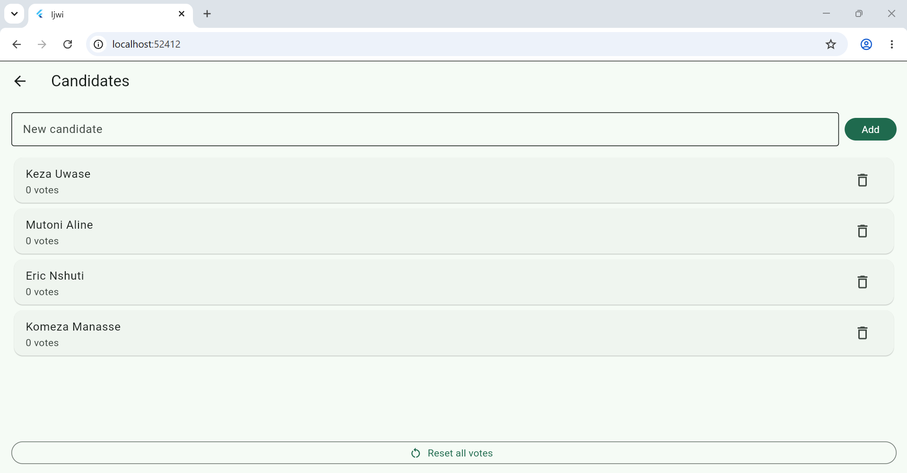
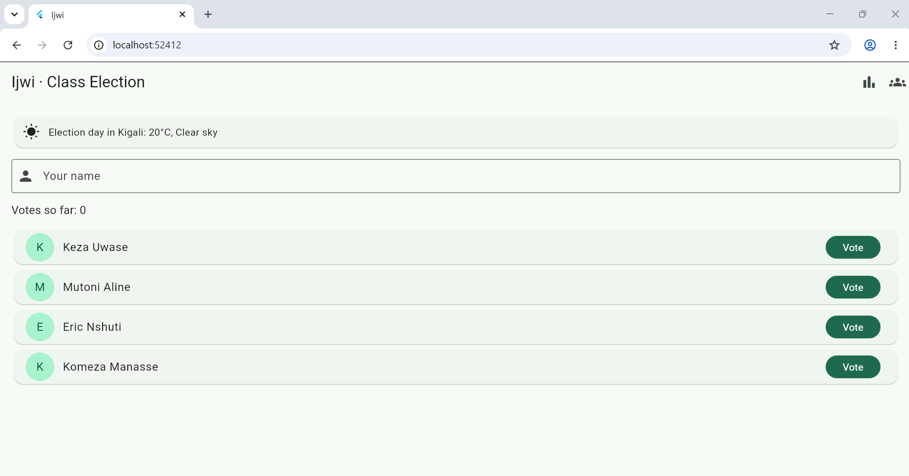
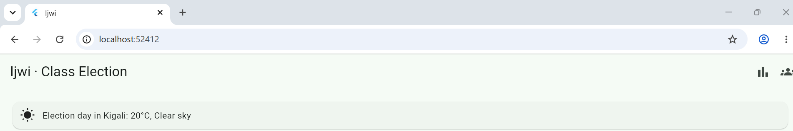
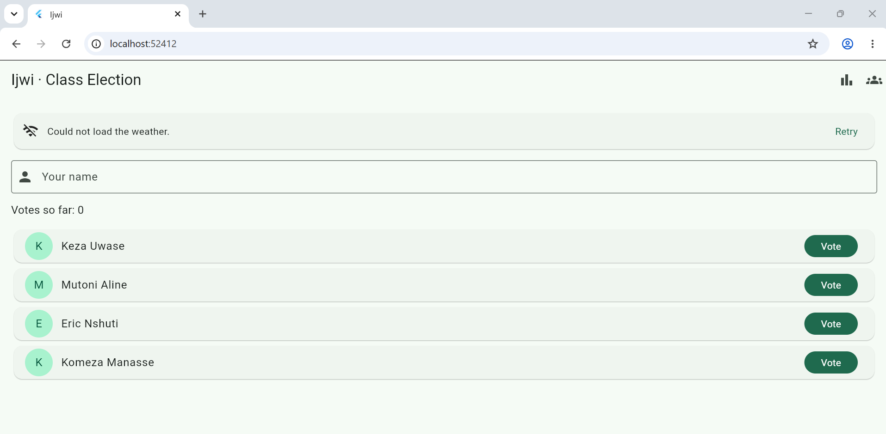

Ijwi · Class Election

A class election app where every student votes exactly once and the results show the winner or a tie. Each user logs in and their data is saved in the cloud with Firebase, so nothing is lost when the app closes, and it shows today's weather in Kigali from the Open-Meteo API.

## Screenshots

 
 

